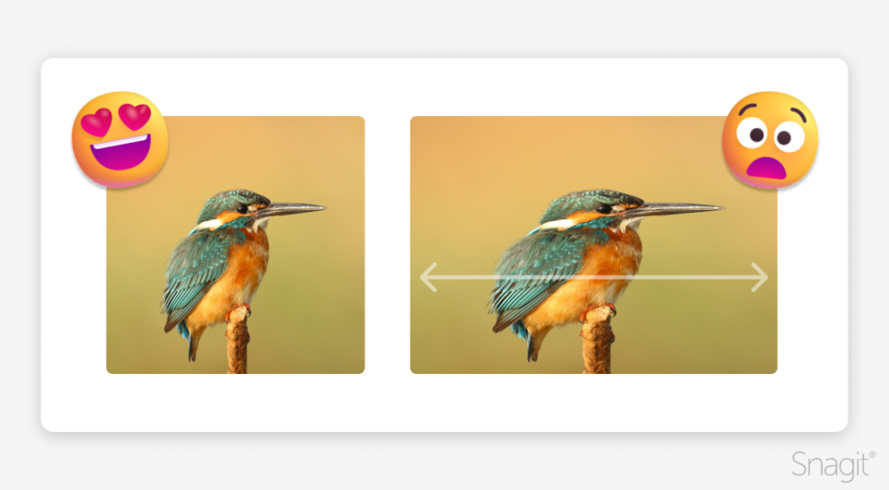
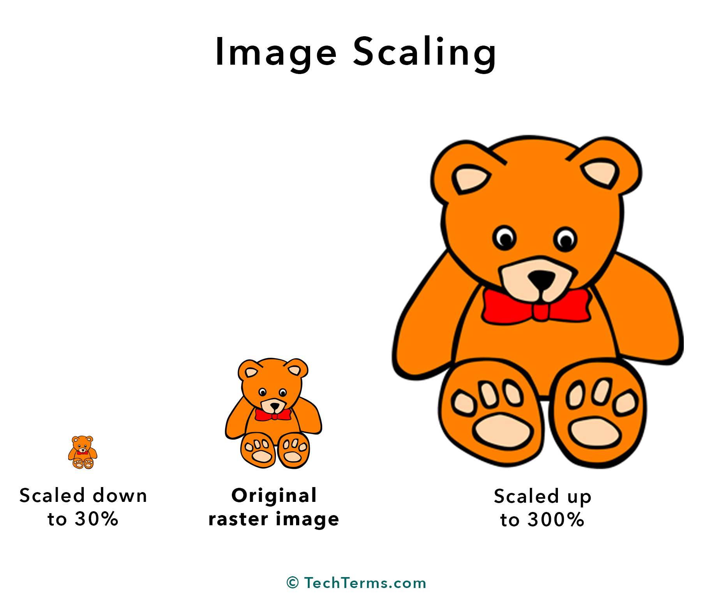
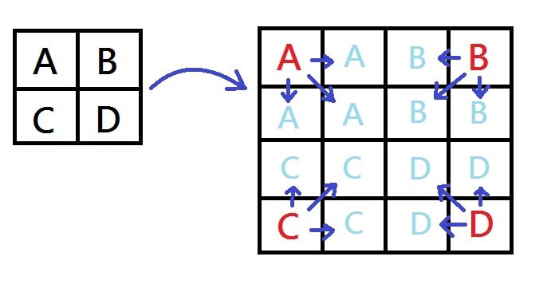

# OpenCV - Image Resizing, Scaling, and Interpolation

Detailed notes based on `transcript.txt`.

 

## 1. What This Lecture Covers

This lecture explains three closely related ideas:

- image resizing,
- image scaling,
- interpolation in OpenCV.

By the end, the goal is to understand:

- how to change image dimensions,
- when aspect ratio should or should not be preserved,
- how OpenCV fills or adjusts pixels during resizing,
- which interpolation method to choose based on speed and quality.

 

## 2. What Is Image Resizing?

Image resizing means changing the width and height of an image to a specific target size.

Example from the lecture:

- Standard resolution: `640 x 480`
- HD resolution: `1280 x 720`

If we directly convert an image from one size to another without caring about whether the original proportions stay the same, that is image resizing.

Important idea:

- resizing changes dimensions,
- but it does not necessarily preserve aspect ratio.

So resizing is the more general operation.

 

## 3. What Is Image Scaling?

Image scaling is also a size change, but with one important rule:

- the aspect ratio is maintained.

Example from the lecture:

- HD: `1280 x 720`
- Full HD: `1920 x 1080`

Both of these resolutions use the same aspect ratio:

- `16:9`

So when we move from HD to Full HD while keeping the same proportions, that is scaling.

In simple words:

- all scaling is resizing,
- but not all resizing is scaling.

 

## 4. Resizing vs Scaling

The main difference is whether the aspect ratio is preserved.

Image resizing:

- width and height are changed to the required target,
- aspect ratio may change,
- the image can look stretched, squeezed, wider, or taller.

Image scaling:

- width and height are changed proportionally,
- aspect ratio stays the same,
- the image keeps its original visual proportions.

This distinction is one of the most important ideas in the lecture.

 

## 5. Understanding Aspect Ratio

Aspect ratio describes the relationship between width and height.

Examples:

- `640 x 480` has aspect ratio `4:3`
- `1280 x 720` has aspect ratio `16:9`
- `1920 x 1080` also has aspect ratio `16:9`

If we move from a `4:3` image to a `16:9` image without cropping, the image content must stretch or compress to fit the new shape.

That is why preserving aspect ratio matters in many tasks.

 

## 6. Upscaling and Downscaling

Scaling can happen in two directions.

Upscaling:

- converting from a smaller image to a larger image,
- example: a lower-resolution image to a higher-resolution image.

Downscaling:

- converting from a larger image to a smaller image,
- example: Full HD to HD or to a standard resolution.

The lecture emphasizes that both are useful depending on the requirement.

 

## 7. Why We Resize or Scale Images

The lecture mentions several practical reasons:

- to convert images to a required target resolution,
- to reduce memory usage,
- to reduce storage size,
- to make transmission easier,
- to normalize image dimensions for machine learning models,
- to prepare images for specific applications such as thumbnails,
- to enlarge images for larger displays or outputs.

This is why resizing and scaling are very common preprocessing steps in computer vision.

 

## 8. Why Aspect Ratio Matters Visually

The lecture uses a giraffe example to show the visual difference.

Original image:

- rectangular image,
- dimensions roughly `1067 x 1704`

Resized version:

- forced into a square shape,
- aspect ratio changes,
- the giraffe looks wider and slightly distorted.

Scaled version:

- dimensions are reduced proportionally,
- aspect ratio is preserved,
- the giraffe keeps the same overall appearance, only smaller.

So:

- resizing may distort content,
- scaling preserves the natural look of the image.

 

## 9. Core Idea Behind Interpolation

Interpolation determines how new pixel values are calculated when an image is resized.

This matters because:

- in upscaling, new pixels need to be created,
- in downscaling, some original pixel information must be combined or discarded.

So interpolation is **the rule that decides how OpenCV computes the new pixel values**.

 

## 10. Intuition with a `2 x 2` to `4 x 4` Example

The lecture explains interpolation using a tiny image.

Suppose the original image is:

- `2 x 2`
- pixels are labeled `A`, `B`, `C`, `D`

If we enlarge it to:

- `4 x 4`

then many new pixel positions appear in the larger image.

Those new positions do not already have values, so OpenCV must estimate them.

That estimation step is interpolation.

Similarly, when shrinking an image:

- multiple original pixels may need to be represented by fewer pixels,
- so OpenCV must decide what information to keep.

 

## 11. Interpolation Methods in OpenCV

The lecture introduces these common OpenCV interpolation options:

- `cv2.INTER_NEAREST`
- `cv2.INTER_LINEAR`
- `cv2.INTER_CUBIC`
- `cv2.INTER_AREA`
- `cv2.INTER_LANCZOS4`

Each one handles pixel calculation differently, so each produces a different tradeoff between:

- speed,
- smoothness,
- sharpness,
- computational cost.

 

## 12. `cv2.INTER_NEAREST`

This is the simplest interpolation method.

Idea:

- each new pixel gets the value of the nearest pixel from the original image.

In the lecture's `2 x 2` to `4 x 4` example:

- large blocks of the same original pixel value get copied into nearby empty positions.

Main effect:

- very fast,
- but produces blocky or pixelated output.

This is why enlarged images often look rough when nearest-neighbor interpolation is used.

 

## 13. `cv2.INTER_LINEAR`

This method uses nearby pixels and computes an average-based value.

Effect:

- smoother than nearest-neighbor,
- less blocky,
- often a good default choice.

The lecture explains the smoothness intuitively:

- when several pixel values are averaged, the result tends to land between them,
- that creates softer transitions instead of hard edges.

So `INTER_LINEAR` is a balance between:

- better visual quality,
- and reasonable speed.

 

## 14. `cv2.INTER_CUBIC`

This method uses more neighboring pixels than linear interpolation.

The lecture describes it as:

- considering the nearest `16` pixels,
- producing smoother results.

Practical takeaway:

- smoother and often better-looking than linear,
- but slower than simpler methods,
- useful when quality matters more than speed.

In the lecture's visual comparison, `INTER_CUBIC` appears smoother and richer than `INTER_LINEAR`.

 

## 15. `cv2.INTER_AREA`

This method computes pixel values based on the image area relationship.

Practical intuition:

- it combines pixel information in a way that is often useful when reducing image size.

The lecture groups it as another averaging-style method and compares its output visually with simpler interpolation choices.

The key point for notes is:

- it is another OpenCV interpolation option,
- it behaves differently from nearest, linear, and cubic,
- it is often chosen when shrinking images.

 

## 16. `cv2.INTER_LANCZOS4`

This is one of the more advanced interpolation methods.

The lecture describes it as:

- using a Lanczos kernel,
- considering a larger neighboring region,
- producing very high-quality results,
- but being computationally expensive.

Practical takeaway:

- better visual quality,
- fewer rough edges,
- slower than simpler interpolation methods.

In the lecture comparison, this method is presented as one of the best-looking options.

 

## 17. Visual Comparison from the Lecture

The lecture compares different interpolation methods by enlarging a very small giraffe image to `600 x 600`.

Observed behavior:

- `INTER_NEAREST` looks the most pixelated.
- `INTER_LINEAR` looks smoother because of averaging.
- `INTER_CUBIC` looks smoother and visually better than linear.
- `INTER_LANCZOS4` appears to reduce rough edges even more.

This comparison helps build intuition:

- faster methods often look rougher,
- higher-quality methods usually need more computation.

 

## 18. Choosing the Right Interpolation

The lecture's practical decision rule is:

- use simpler interpolation when speed matters,
- use more advanced interpolation when visual quality matters more.

Rough guide:

- `INTER_NEAREST`: fastest, but pixelated
- `INTER_LINEAR`: smoother and commonly useful
- `INTER_CUBIC`: better quality, slower
- `INTER_LANCZOS4`: high quality, most computationally expensive among the methods discussed

So the "best" interpolation depends on:

- available computational power,
- how much time you can spend,
- whether you want speed or image quality.

 

## 19. Why Interpolation Matters in Practice

Interpolation directly affects the final appearance of resized images.

It influences:

- sharpness,
- smoothness,
- visible edges,
- pixelation,
- overall image quality.

So resizing is not just about changing numbers like width and height.

It is also about deciding how the image content should be reconstructed at the new size.

 

## 20. Important Study Points

- Resizing changes image dimensions.
- Scaling changes image size while preserving aspect ratio.
- Upscaling means smaller to larger.
- Downscaling means larger to smaller.
- Changing aspect ratio can distort the image.
- Interpolation decides how pixel values are computed after resizing.
- Different interpolation methods trade off speed and quality differently.

These are the main ideas to remember from the lecture.

 

## 21. Summary

This lecture teaches that image resizing and image scaling are related but not identical.

- Resizing changes width and height to a target size.
- Scaling preserves aspect ratio while changing size.

The lecture also shows that interpolation is the key step that controls image quality during resizing.

OpenCV provides several interpolation methods such as:

- `INTER_NEAREST`
- `INTER_LINEAR`
- `INTER_CUBIC`
- `INTER_AREA`
- `INTER_LANCZOS4`

Each method has its own tradeoff between:

- speed,
- smoothness,
- quality.

The most practical conclusion is:

- choose the resize method based on whether aspect ratio must be preserved,
- choose the interpolation method based on whether speed or visual quality is more important.
