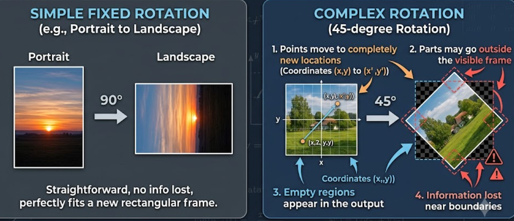
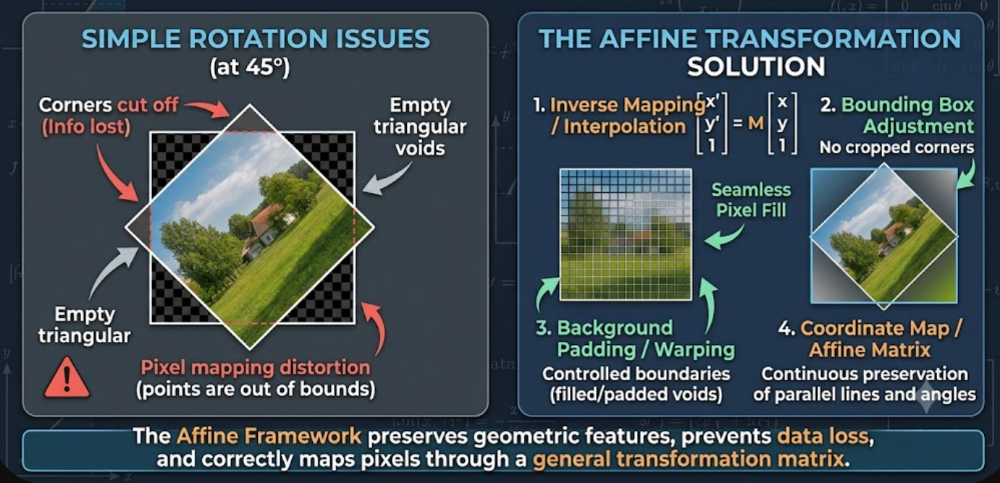
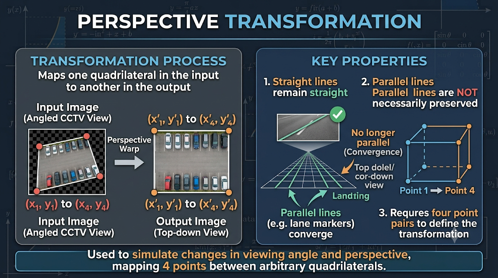
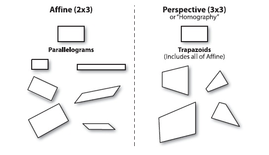

# OpenCV - Affine and Perspective Transformations

These notes cover advanced geometric image transformations in OpenCV, specifically **Affine** and **Perspective** transformations. These operations go beyond basic flips or fixed-angle rotations, providing fine control over how image points map from an input to an output image.

<br/>

## 1. Why Geometric Transformations Matter

Basic operations (like portrait-to-landscape rotation) are straightforward. However, complex operations are needed when:

* Rotating an image by arbitrary angles (e.g., $45^\circ$).

* Scaling, shifting, or shearing an image.

* Correcting optical or perspective distortions.

* Aligning images.



When performing arbitrary rotations, pixels move to completely new locations, parts of the image may fall outside the visible frame, and empty regions may appear. A general transformation framework solves this by mathematically mapping old coordinates to new ones.

<br/>

## 2. Core Idea: Coordinate Mapping

Both affine and perspective transformations work by mapping an original pixel coordinate $(x, y)$ to a new coordinate $(x', y')$.

```
graph LR
    subgraph Input Image
        A["Original Pixel: (x, y)"]
    end
    
    subgraph Transformation
        M["Transformation Matrix"]
    end
    
    subgraph Output Image
        B["New Pixel: (x', y')"]
    end

    A --> M --> B

```

<br/>

## 3. Affine Transformations

An affine transformation is a linear mapping that modifies an image's shape or orientation while preserving its fundamental geometric structure.



**Key Properties:**

* **Straight lines remain straight.**

* **Parallel lines remain parallel.**

* Defined by **three point pairs** (three points in the input image and their corresponding locations in the output).

<br/>

### The General Affine Matrix

Affine transformations use a $2 \times 3$ matrix to calculate the new coordinates:

$$
\begin{bmatrix} x' \\ y' \end{bmatrix} = \begin{bmatrix} a & b & t_x \\ c & d & t_y \end{bmatrix} \begin{bmatrix} x \\ y \\ 1 \end{bmatrix}
$$

* $a$ and $b$ control horizontal behavior (scaling/shearing).

* $c$ and $d$ control vertical behavior (scaling/shearing).

* $t_x$ controls translation along the X-axis.

* $t_y$ controls translation along the Y-axis.

<br/>

### Types of Affine Operations

By altering the values in the $2 \times 3$ matrix, we can achieve different transformations:

#### A. Translation (Shifting)

Moves the image without changing its shape. Positive $t_x$ moves right; positive $t_y$ moves downward.

$$
\begin{bmatrix} 1 & 0 & t_x \\ 0 & 1 & t_y \end{bmatrix}
$$

<br/>

#### B. Scaling (Resizing)

Enlarges or shrinks the image using horizontal ($s_x$) and vertical ($s_y$) scale factors.

$$
\begin{bmatrix} s_x & 0 & 0 \\ 0 & s_y & 0 \end{bmatrix}
$$

<br/>

#### C. Rotation

Rotates the image by an arbitrary angle $\theta$.

$$
\begin{bmatrix} \cos(\theta) & -\sin(\theta) & 0 \\ \sin(\theta) & \cos(\theta) & 0 \end{bmatrix}
$$

#### D. Shearing

Slants the shape of the image (like pulling opposite corners of a rectangle).

**X-Shear:**

$$
\begin{bmatrix} 1 & sh_x & 0 \\ 0 & 1 & 0 \end{bmatrix}
$$

**Y-Shear:**

$$
\begin{bmatrix} 1 & 0 & 0 \\ sh_y & 1 & 0 \end{bmatrix}
$$

<br/>

## 4. Perspective Transformations

Perspective transformation maps one quadrilateral in the input image to another in the output image. Its primary purpose is to simulate a change in viewing angle or camera perspective (e.g., converting an angled CCTV view of a parking lot into a top-down view).



**Key Properties:**

* **Straight lines remain straight.**

* **Parallel lines are NOT necessarily preserved.** (Parallel lines in the real world might converge in the image, mimicking depth and perspective).

* Requires **four point pairs** to define the transformation.

<br/>

## 5. Summary: Affine vs. Perspective



| **Feature** | **Affine Transformation** | **Perspective Transformation** | 
| **Preserves Straightness?** | Yes | Yes | 
| **Preserves Parallelism?** | Yes | No | 
| **Required Point Pairs** | 3 | 4 | 
| **Primary Use Cases** | Scaling, rotation, translation, shearing (same viewing plane). | Viewpoint correction, top-view conversion, simulating camera angles. | 

*Note: When applying these transformations, some original information may move outside the output frame, resulting in black or empty areas in the final image.*