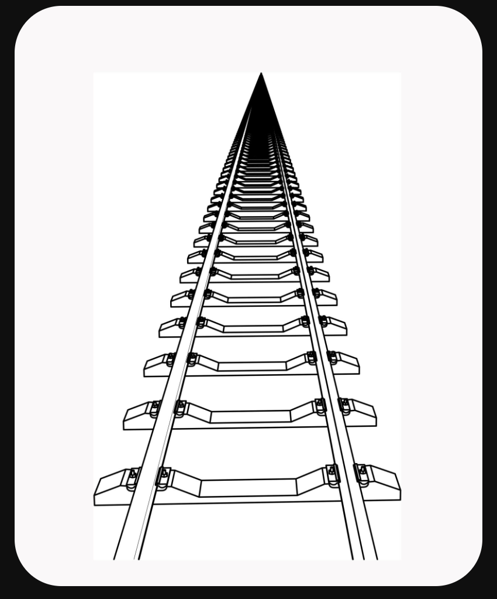

## Straight Line in an Image
A straight line is a continuous, unbending sequence of pixels connecting two points.

Because digital images are made of a grid of square pixels, a straight line that is perfectly horizontal or vertical is simply a straight row or column of pixels. However, if the line is at an angle, the computer must approximate it using a "staircase" pattern of pixels (a phenomenon known as aliasing).

Algorithms like the Hough Transform in OpenCV are specifically designed to find these pixel arrangements and recognize them mathematically as straight lines, which is crucial for detecting lane markings, building edges, or documents.

## Parallel Lines in an Image
Parallel lines are two or more straight lines in an image that run in the exact same direction and never intersect. The perpendicular distance between them remains constant across the entire image.

### Why This Matters for Image Transformations
The concept of parallel lines is the defining difference between the two core image transformations in OpenCV:

* **Affine Transformations (Parallelism Preserved):** When you rotate, scale, shear, or translate an image, any lines that were parallel in the original image will remain parallel in the output image.

* **erspective Transformations (Parallelism Lost):** When you change the 3D viewing angle of an image (like looking down a long road), lines that are parallel in the real world will appear to converge at a "vanishing point" in the 2D image. Perspective transformations can manipulate these vanishing points.