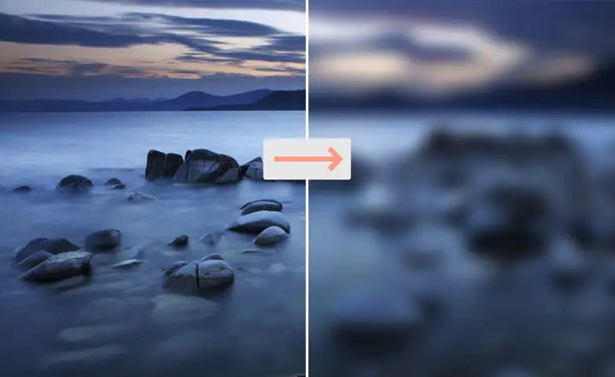
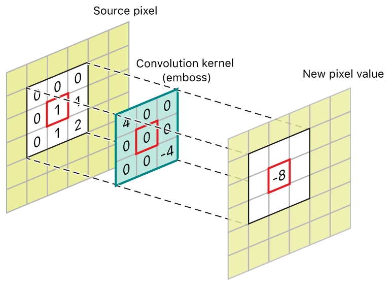
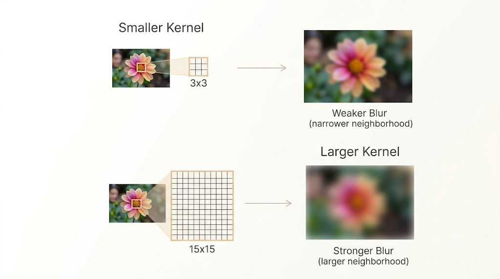
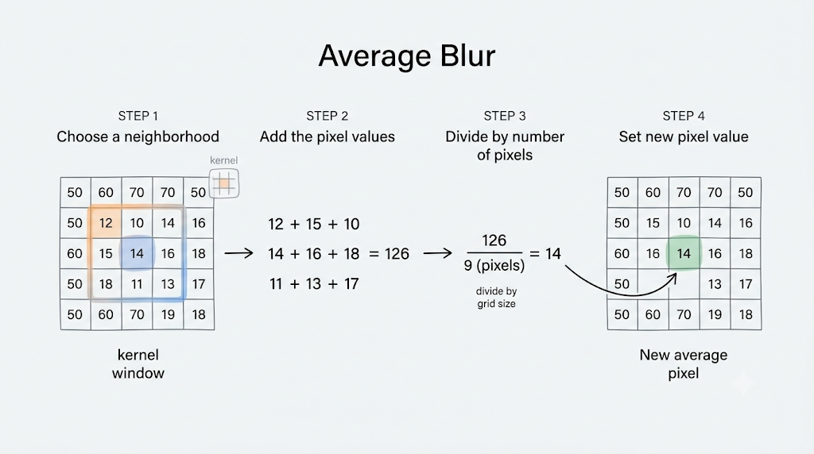
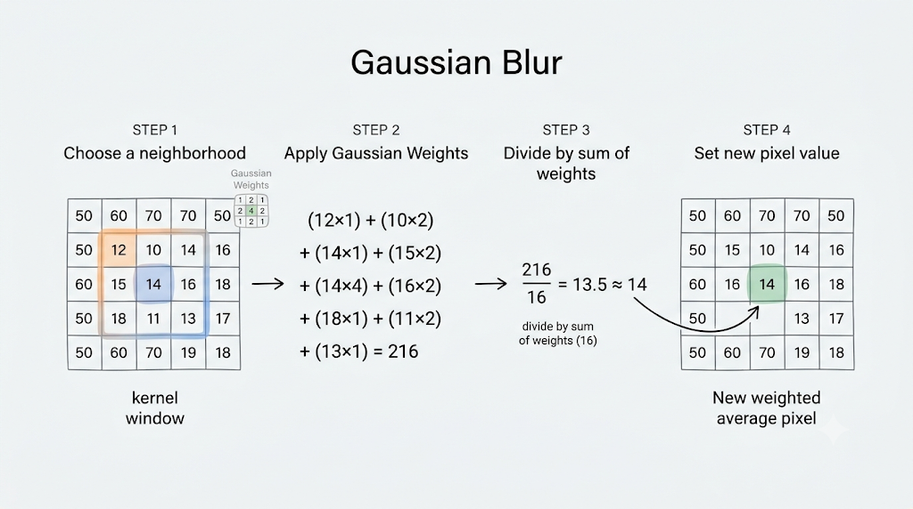
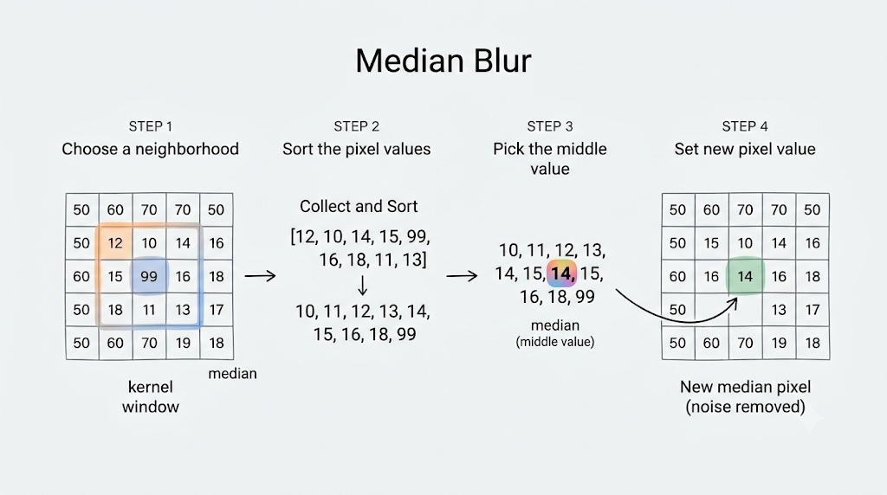
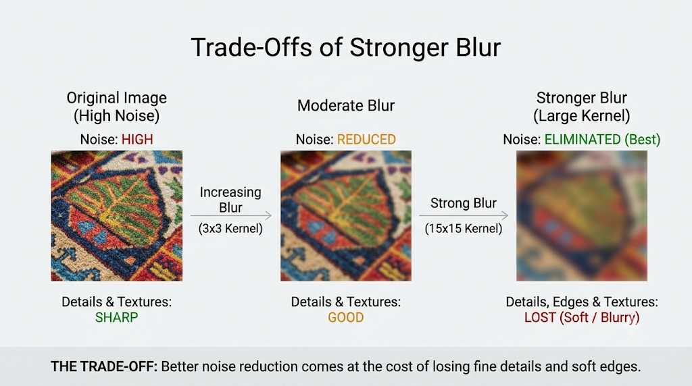

# OpenCV - Applying Blur Filters

## 1. What This Lecture Covers

This lecture introduces blur filters in OpenCV and explains why blurring is useful in image processing.

The theory focuses on three common blur filters:

- average blur,
- Gaussian blur,
- median blur.

The main goal is to understand what blurring does to an image and when each blur type is most useful.

 

## 2. What Is Blurring?

Blurring is a technique used to reduce sharp transitions in an image.

It works by combining pixel values inside a small local neighborhood so that sudden intensity changes become smoother.

In simple terms:

- sharp edges become softer,
- abrupt intensity changes become more gradual,
- the image looks smoother than before.

 

## 3. Local Neighborhood Idea

The lecture explains blurring using the idea of a local region around a pixel.

Instead of treating each pixel completely independently, blur filters look at nearby pixels and compute a new value from that neighborhood.

So the output value of one pixel depends on:

- the current pixel,
- surrounding pixels inside the kernel window.

This is why blur filters smooth local variations rather than changing the whole image in one step.

 

## 4. Why Blurring Works

Blurring reduces strong pixel-to-pixel differences.

If nearby pixels have very different values, the blur operation replaces that sharp contrast with a value that is more balanced.

That means:

- very bright isolated pixels lose intensity,
- very dark isolated pixels rise toward nearby values,
- sudden zigzag-like changes become smoother.

This is the core reason blur filters reduce visual harshness.

 

## 5. Main Uses of Blurring

The lecture highlights two major uses of blurring:

- noise reduction,
- image smoothing.

These are closely related, because noise often appears as abrupt intensity changes that do not belong to the real image content.

By smoothing local neighborhoods, blur filters suppress many of those unwanted fluctuations.

 

## 6. Blurring and Noise Reduction

Noise often appears as random pixel intensity variations.

For example, some pixels may randomly become:

- very bright,
- very dark,
- or inconsistent with the surrounding region.

When blur is applied, those isolated extreme values are combined with neighboring values, which reduces their visual impact.

So blurring can help make noisy images look cleaner.

 

## 7. Kernel in Blur Filters

Just like other image filters, blur filters rely on a kernel.

The kernel defines:

- the size of the neighborhood,
- how many nearby pixels are considered,
- how strongly each nearby pixel influences the result.

In blur operations, kernel size plays a major role in how strong the blur becomes.

 

## 8. Kernel Size and Blur Strength

The lecture emphasizes an important pattern:

- a smaller kernel gives a weaker blur,
- a larger kernel gives a stronger blur.

This happens because a larger kernel mixes information from a bigger neighborhood, producing a more aggressive smoothing effect.

So blur strength is closely tied to how large the neighborhood is.

 

## 9. Average Blur

Average blur is the most straightforward blur method in the lecture.

It works by replacing each output pixel with the average of surrounding pixel values inside the kernel window.

So the process is:

1. choose a neighborhood around the pixel,
2. add the pixel values in that region,
3. divide by the number of pixels,
4. use that average as the new pixel value.

This gives a simple smoothing effect.

 

## 10. Intuition Behind Average Blur

Average blur treats all pixels inside the kernel equally.

That means:

- the center pixel does not get special importance,
- nearby and slightly farther pixels inside the window contribute the same way,
- the result is a uniform smoothing operation.

This makes average blur easy to understand and useful as a basic blur method.

 

## 11. When Average Blur Is Useful

According to the lecture, average blur is useful when we want:

- basic smoothing,
- simple blur,
- some reduction of random noise.

It is a good starting point when we want to soften an image without using a more specialized blur method.

 

## 12. Gaussian Blur

Gaussian blur is a more advanced and more natural-looking blur.

Instead of taking a plain average, it uses a **weighted average**.

This means:

- pixels closer to the center have more influence,
- pixels farther from the center have less influence.

So the blur is not uniform across the whole kernel window.

 

## 13. Why Gaussian Blur Looks More Natural

Because Gaussian blur gives more weight to nearby pixels, it usually produces smoother and more visually natural results than simple average blur.

This is why the lecture compares it to a more quality-oriented blur effect.

The idea is:

- local structure near the center is respected more,
- outer pixels still contribute, but less strongly,
- the transition into blur feels softer and more natural.

 

## 14. Gaussian Distribution Intuition

The lecture explains Gaussian blur using the idea that influence is strongest near the center and weaker farther away.

So inside the kernel:

- center-adjacent pixels matter more,
- outer pixels matter less.

This weighting pattern is what distinguishes Gaussian blur from plain averaging.

 

## 15. Sigma in Gaussian Blur

The lecture introduces `sigma` as a parameter that controls the spread of the Gaussian blur.

Conceptually:

- a larger sigma creates a smoother and stronger blur,
- a smaller sigma keeps the blur tighter and less spread out.

So Gaussian blur strength depends not only on kernel size, but also on the Gaussian spread.

 

## 16. Kernel Size Rule for Gaussian Blur

One practical point from the lecture is that Gaussian blur expects an odd kernel size.

Examples of valid sizes include:

- `3`
- `5`
- `15`
- `31`

This matters because the kernel needs a clear center position for the weighted averaging process.

 

## 17. Median Blur

Median blur works differently from both average blur and Gaussian blur.

Instead of using an average, it replaces each pixel with the **median** of the surrounding pixel values.

So the steps are:

1. collect the pixel values in the local window,
2. sort or conceptually order them,
3. pick the middle value,
4. use that median as the new pixel value.

This makes median blur especially useful for a certain kind of noise.

 

## 18. Why Median Blur Is Special

The median is resistant to extreme values.

That means if a neighborhood contains a few unusual pixels that are much brighter or much darker than the rest, the median is less affected by them than an average would be.

So median blur is especially good at removing isolated noisy pixels while preserving the broader local structure better than a plain average in those cases.

 

## 19. Salt-and-Pepper Noise

The lecture specifically mentions salt-and-pepper noise.

This kind of noise appears as random light and dark spots scattered across the image.

Because these noisy pixels are often isolated extremes, median blur is particularly effective at reducing them.

That is one of the most important practical reasons to choose median blur.

 

## 20. Average vs Gaussian vs Median

The three blur types can be compared as follows:

- **Average blur** uses a plain average over the kernel window.
- **Gaussian blur** uses a weighted average, with stronger emphasis near the center.
- **Median blur** replaces the value with the median of the neighborhood.

So although all three smooth the image, they do not behave the same way and are useful in different situations.

 

## 21. Choosing the Right Blur

Based on the lecture:

- use **average blur** for simple smoothing,
- use **Gaussian blur** for smoother and more natural-looking blur,
- use **median blur** when noise reduction is especially important, particularly for salt-and-pepper noise.

So the right blur depends on whether the goal is simple smoothing, visually pleasing blur, or stronger robustness to noisy outliers.

 

## 22. Trade-Offs of Stronger Blur

A stronger blur can reduce noise more effectively, but it also removes more fine detail.

Image noise is an unwanted random variation in brightness, color, or transparency that obscures fine detail in a digital photo, scan, or video. It often appears as a grainy, speckled, or mottled texture—similar to vintage film grain, though digital noise is generally considered a defect

This means:

- edges become softer,
- texture becomes less visible,
- image details may be lost.

The lecture hints at this trade-off, especially when larger kernel sizes are used or when median blur changes the appearance of the image more noticeably.

 

## 23. What the Output Represents

The blurred image is not trying to highlight features like an edge detector.

Instead, it suppresses local variation to produce a smoother version of the original image.

So after blur:

- noise may be reduced,
- transitions may become softer,
- the image may look cleaner but less sharp.

This is the expected behavior of smoothing filters.

 

## 24. Key Takeaways

- Blurring reduces sharp local intensity transitions in an image.
- Blur filters work by combining pixel values inside a local neighborhood.
- Larger kernels generally produce stronger blur.
- Average blur uses a plain average of surrounding pixels.
- Gaussian blur uses a weighted average with higher importance near the center.
- Gaussian blur usually produces a smoother and more natural-looking result.
- Median blur replaces each pixel with the median of nearby values.
- Median blur is especially effective for salt-and-pepper noise.
- Blurring helps with smoothing and noise reduction, but stronger blur can remove useful detail.

 

## 25. Summary

This lecture introduces blur filters as smoothing operations that reduce harsh intensity changes and unwanted noise.

Average blur provides a simple neighborhood average, Gaussian blur produces a more natural weighted smoothing effect, and median blur is especially useful for removing isolated noisy pixels.

Together, these filters form an important foundation for image preprocessing, noise reduction, and preparing images for later computer vision tasks.
