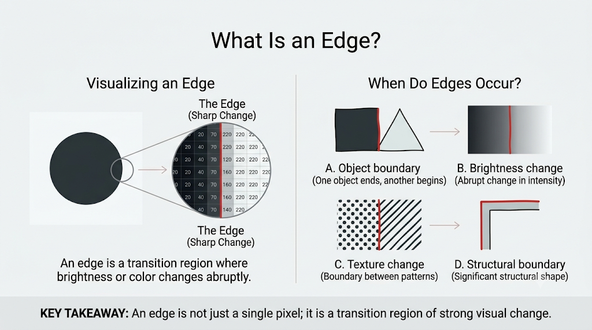
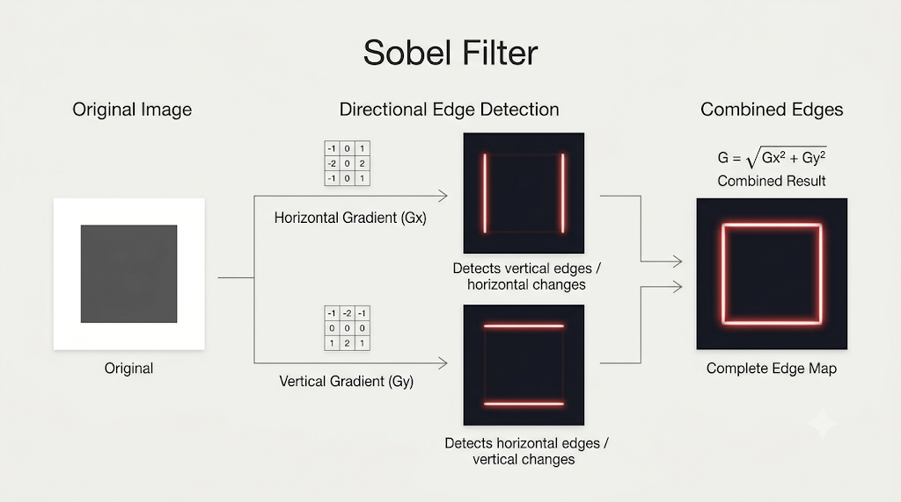
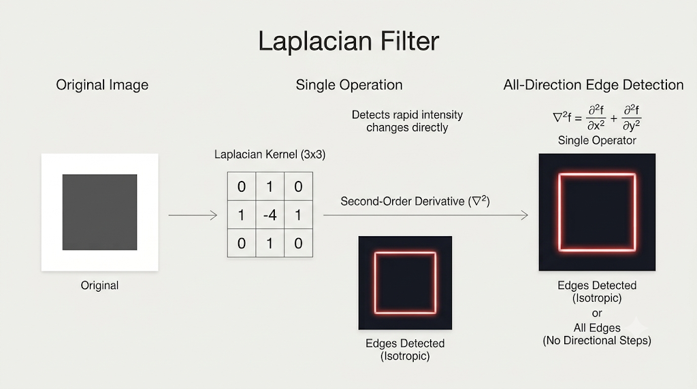
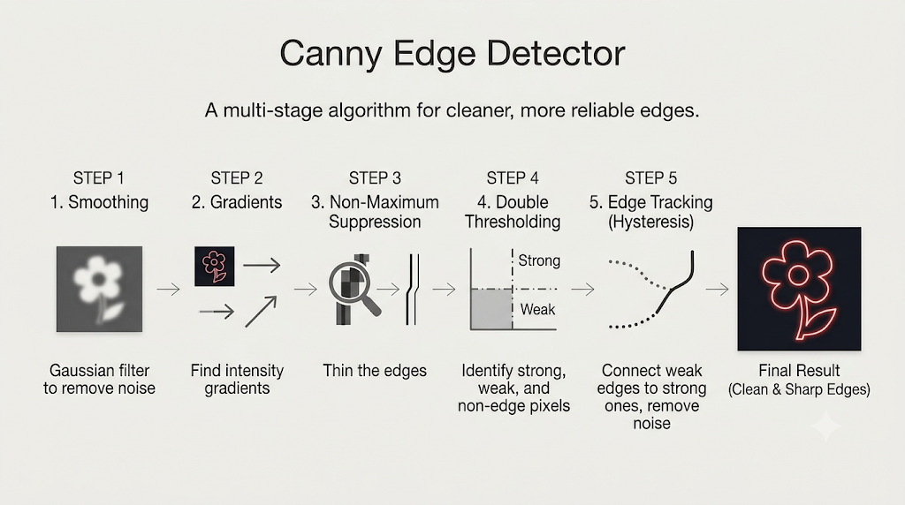

# OpenCV - Edge Detection

## 1. What This Lecture Covers

This lecture introduces edge detection in image processing and explains how OpenCV can be used to detect important structural boundaries in an image.

The theory focuses on three common edge detection methods:

- Sobel filter,
- Laplacian filter,
- Canny edge detector.

The lecture also explains what an edge is, why edges matter, and how different algorithms detect them.

<br/>

## 2. What Is an Edge?

An edge is a sharp change in intensity or color in an image.



In practice, an edge often appears where:

- one object ends and another begins,
- the brightness changes abruptly,
- texture changes significantly,
- an important structural boundary is present.

So an edge is not just any pixel. It is usually a transition region where the image changes strongly.

<br/>

## 3. Intuition Behind Edges

The lecture explains edges using simple regions of different shades.

If an image contains adjacent areas such as:

- white,
- gray,
- dark gray,

then the boundaries between those regions are edges because the intensity changes sharply there.

So edge detection is really the process of finding strong transitions in image values.

<br/>

## 4. Why Edge Detection Matters

Edge detection is an important part of computer vision because it helps identify the structural content of an image.

Instead of focusing on full color and shading information, edge detection highlights the outline and geometry of objects.

This makes it useful when we care more about structure than appearance.

<br/>

## 5. Main Uses of Edge Detection

The lecture highlights several key uses:

- feature extraction,
- shape analysis,
- preprocessing for machine learning and deep learning,
- boundary detection,
- contour detection.

These uses all depend on the same idea: edges summarize important structural information in a simpler form.

<br/>

## 6. Edge Detection as Structural Simplification

The lecture gives an intuitive example of tracing the outline of an object, like drawing the outline of a house with a pencil.

This analogy is useful because edge detection behaves similarly:

- it ignores unnecessary shading,
- it reduces dependence on raw color information,
- it preserves the important outer and inner structure.

So edge detection can be thought of as converting a detailed image into a more abstract structural representation.

<br/>

## 7. Why This Helps in AI and CNN Workflows

The lecture emphasizes that AI models often benefit from structural information.

If the task is to understand the object itself rather than its exact color or shading, edges can provide a cleaner representation of the shape.

This is why edge detection is commonly used in preprocessing:

- it removes some irrelevant appearance details,
- it emphasizes boundaries and form,
- it can make later analysis easier.

<br/>

## 8. Common Edge Detection Methods in This Lecture

The lecture covers three methods:

- Sobel,
- Laplacian,
- Canny.

All three try to find regions of strong intensity change, but they do so in different ways and with different levels of sophistication.

<br/>

## 9. Gradient-Based Edge Detection

Much of edge detection is based on the idea of a gradient.

A gradient tells us how quickly image intensity is changing.

If the change is:

- small, the region is probably smooth,
- large, the region may contain an edge.

So many edge detectors try to estimate the strength and sometimes the direction of intensity change.

<br/>

## 10. Sobel Filter

The Sobel filter detects edges by estimating image gradients in two directions:

- horizontal direction,
- vertical direction.



In practice, Sobel computes directional changes separately and then combines them.

This makes it useful for detecting edges that have strong orientation along the image axes.

<br/>

## 11. Sobel Kernels

The lecture presents Sobel as using two kernels:

- one for the `x` direction,
- one for the `y` direction.

These kernels are applied through convolution, just like other filters.

The result is two intermediate gradient images:

- one showing change along `x`,
- one showing change along `y`.

<br/>

## 12. Sobel Output Components

After applying the two Sobel kernels, we get:

- `Gx` for horizontal intensity change,
- `Gy` for vertical intensity change.

Each of these tells us how strongly the image is changing in its own direction.

But to get an overall edge strength, the two must be combined.

<br/>

## 13. Sobel Gradient Magnitude

The lecture explains that Sobel combines the directional gradients by computing the gradient magnitude.

The magnitude is calculated as:

```text
G = sqrt(Gx^2 + Gy^2)
```

This is done pixel by pixel.

The resulting magnitude matrix tells us how strong the edge is at each location, regardless of whether the change came more from the `x` direction or the `y` direction.

<br/>

## 14. Thresholding After Sobel

Once the gradient magnitude is computed, a threshold can be applied.

The lecture explains the idea like this:

- values above the threshold are treated as edges,
- values below the threshold are treated as non-edges.

So thresholding converts a continuous edge-strength map into a more usable edge result.

The exact threshold usually needs tuning depending on the image.

<br/>

## 15. Strengths of Sobel

Sobel is useful because:

- it is conceptually simple,
- it gives directional gradient information,
- it provides a reasonable edge map with relatively moderate complexity.

It is often a strong baseline when we want to detect edges without using a more advanced multi-stage detector.

<br/>

## 16. Laplacian Filter

The Laplacian filter detects edges by finding regions of rapid intensity change.

Unlike Sobel, Laplacian does not separately compute `x` and `y` gradients and then combine them afterward in the same way.



Instead, it uses a single operation that captures intensity variation more directly.

The lecture describes it as relying on a second-order derivative approximation.

<br/>

## 17. Laplacian as a Second-Order Derivative

The Laplacian kernel is presented as a discrete approximation of a continuous second-order derivative.

The main idea is:

- Sobel is tied to directional first-derivative behavior,
- Laplacian reflects second-order change behavior.

This makes Laplacian very sensitive to sudden intensity changes, which is why it can highlight edges strongly.

<br/>

## 18. Laplacian Kernels

The lecture mentions that Laplacian can be expressed using different kernels.

These kernels are different discrete approximations of the same general idea and can vary in how strongly they emphasize edge intensity.

So there may be multiple valid Laplacian kernels depending on the exact formulation being used.

<br/>

## 19. Why Laplacian Can Look Noisy

The lecture points out an important practical issue: Laplacian can produce both positive and negative values.

This happens because second-order derivative responses can go in different signed directions.

Since edges are about change strength rather than sign alone:

- raw Laplacian output may look harder to interpret,
- taking absolute values can make the result easier to visualize,
- but this can also make noise more visible.

So Laplacian is often powerful, but it can be noisier than more refined approaches.

<br/>

## 20. Canny Edge Detector

Canny is presented as the most advanced of the three methods covered in the lecture.

It is not just a single convolution step. Instead, it is a multi-stage algorithm designed to produce cleaner and more reliable edges.



It combines several ideas:

- smoothing,
- gradient computation,
- non-maximum suppression,
- double thresholding,
- edge tracking by hysteresis.

<br/>

## 21. Step 1 of Canny: Grayscale Conversion

The first step is to convert the image to grayscale.

The lecture emphasizes that edges are about changes in intensity structure, not about raw color values themselves.

So grayscale simplifies the image while preserving the information needed for edge detection.

<br/>

## 22. Step 2 of Canny: Gaussian Blur

Before detecting edges, Canny applies Gaussian blur.

The purpose is to:

- reduce noise,
- smooth minor variations,
- avoid reacting too strongly to tiny unwanted fluctuations.

This makes the later gradient calculations more stable and less sensitive to small noisy changes.

<br/>

## 23. Step 3 of Canny: Sobel-Based Gradient Computation

After smoothing, Canny computes intensity gradients using Sobel-like operations in the `x` and `y` directions.

From these, it calculates:

- gradient magnitude,
- gradient direction.

The lecture gives the direction idea using:

```text
theta = arctan(Gy / Gx)
```

So Canny uses not only edge strength, but also the direction in which the edge changes.

<br/>

## 24. Why Gradient Direction Matters

Knowing the edge direction helps Canny decide which pixels really belong to the strongest edge path.

Without direction, we would only know that a pixel has a strong change.

With direction, we also know how that change is oriented, which makes later refinement possible.

<br/>

## 25. Step 4 of Canny: Non-Maximum Suppression

Non-maximum suppression is one of the most important refinement steps in Canny.

The idea is:

- look at a pixel's gradient magnitude,
- compare it with neighboring pixels along the gradient direction,
- keep it only if it is the local maximum,
- suppress weaker neighboring responses to zero.

This removes thick or redundant edge responses and keeps only the strongest edge points.

<br/>

## 26. What Non-Maximum Suppression Achieves

Without non-maximum suppression, edge regions may look thick, blurry, or duplicated.

With it:

- edge lines become thinner,
- redundant nearby responses are removed,
- the output becomes cleaner and more precise.

This is one of the main reasons Canny usually looks sharper than basic edge detectors.

<br/>

## 27. Step 5 of Canny: Double Thresholding

The lecture explains double thresholding using two values:

- a high threshold,
- a low threshold.

Pixels are then classified into three groups:

- strong edges,
- weak edges,
- non-edges.

In general:

- values above the high threshold are strong edges,
- values below the low threshold are discarded,
- values in between are treated as weak edges.

This gives Canny a more flexible decision process than a single threshold.

<br/>

## 28. Step 6 of Canny: Edge Tracking by Hysteresis

After double thresholding, Canny performs edge tracking by hysteresis.

This step decides whether weak edges should be kept.

The rule is:

- if a weak edge is connected to a strong edge, keep it,
- otherwise, discard it.

This helps preserve meaningful edge continuity while removing isolated weak responses caused by noise.

<br/>

## 29. Why Canny Usually Produces Cleaner Edges

The lecture suggests that Canny often gives the best visual result because it combines multiple protective steps:

- Gaussian blur reduces noise first,
- gradient magnitude and direction identify edge structure,
- non-maximum suppression thins the edges,
- double thresholding separates strong and weak responses,
- hysteresis keeps only meaningful weak edges.

This makes Canny both selective and robust.

<br/>

## 30. Sobel vs Laplacian vs Canny

A useful comparison from the lecture is:

- **Sobel** detects directional gradients in `x` and `y`, then combines them.
- **Laplacian** captures rapid intensity change using a second-order derivative style operation.
- **Canny** is a multi-step edge detection pipeline designed for cleaner results.

So although all three detect edges, they differ in complexity, noise sensitivity, and output quality.

<br/>

## 31. Noise Sensitivity

The lecture makes it clear that noise is an important issue in edge detection.

- Sobel can detect edges well, but may still show noise.
- Laplacian can become especially noisy because of its sensitivity and signed response.
- Canny manages noise best because smoothing and refinement are built into the pipeline.

So the choice of detector often depends on how noisy the image is and how clean the output needs to be.

<br/>

## 32. Computational Trade-Off

The lecture notes that Canny is the most computationally expensive among the three.

This makes sense because it performs several processing stages instead of a single direct filtering step.

So there is a trade-off:

- simpler methods may be faster,
- more advanced methods may give cleaner edges.

<br/>

## 33. What the Edge Map Represents

The output of edge detection is not a natural-looking image.

Instead, it is a structural map showing where strong boundaries or important transitions occur.

This output is useful because it compresses visual information into a simpler form that highlights shape and form rather than full appearance.

<br/>

## 34. Key Takeaways

- An edge is a sharp change in intensity or color.
- Edge detection is useful for feature extraction, shape analysis, preprocessing, contours, and boundaries.
- Sobel detects directional gradients in horizontal and vertical directions.
- Sobel combines `Gx` and `Gy` using gradient magnitude.
- Thresholding after Sobel helps decide which gradient strengths count as edges.
- Laplacian detects rapid intensity change using a second-order derivative approximation.
- Laplacian may contain positive and negative responses and can appear noisy.
- Canny is a multi-stage edge detector that includes smoothing, gradient computation, non-maximum suppression, double thresholding, and hysteresis.
- Canny usually gives cleaner and more noise-resistant edges than simpler methods.
- More advanced edge detection often costs more computation.

<br/>

## 35. Summary

This lecture introduces edge detection as the process of finding strong structural transitions in an image.

Sobel provides a directional gradient-based approach, Laplacian highlights rapid intensity change through a second-order derivative formulation, and Canny combines multiple stages to produce cleaner and more reliable edges.

Together, these methods form a strong foundation for structural image analysis, preprocessing, and many later computer vision tasks.
