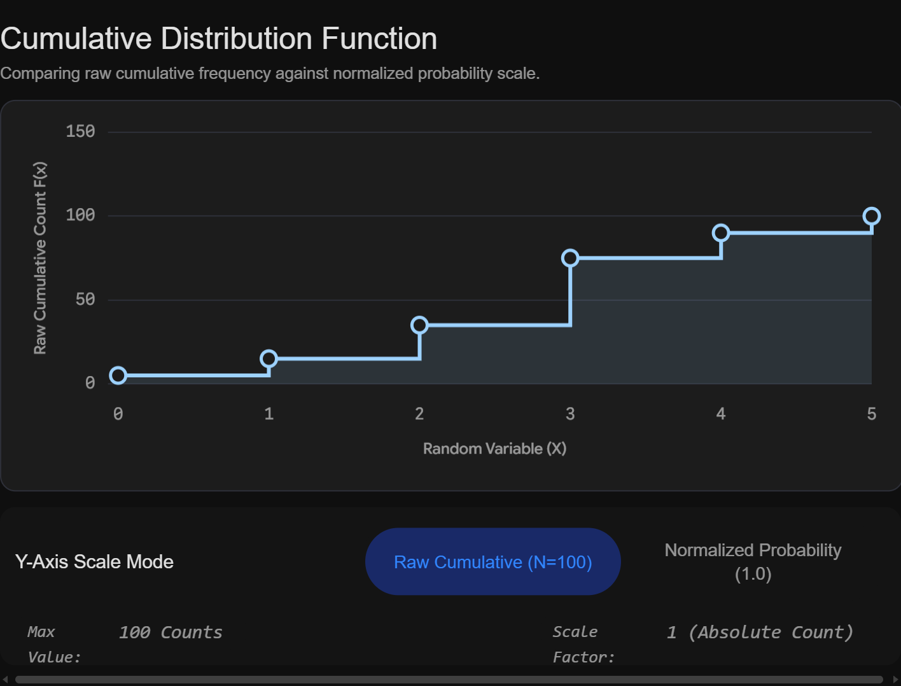
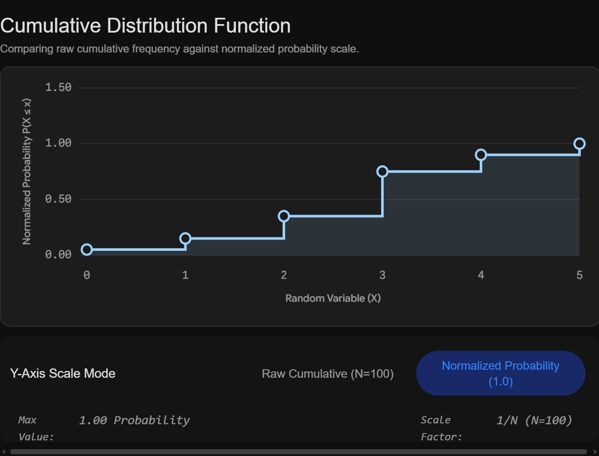

## Cumulative VS normalized cumulative distribution

The core difference between the two is the scale they use: a **cumulative distribution** tracks the raw running total of counts or frequencies, while a **normalized cumulative distribution** (often called the Cumulative Distribution Function or CDF) scales those totals into proportions or probabilities.

Here is the breakdown of how they compare:

### Cumulative Distribution

This represents the absolute count of observations that fall at or below a specific value.

* **Calculation:** You simply add up the frequencies of all outcomes up to that point.
* **Maximum Value:** The final point on the curve is always equal to $N$ (the total number of observations in your dataset).
* **Formula:** For a given value $x_i$, the cumulative frequency $C_i$ is the sum of all previous frequencies $f_j$:

$$C_i = \sum_{j=1}^{i} f_j$$

### Normalized Cumulative Distribution (CDF)

This represents the proportion (or probability) of observations that fall at or below a specific value.

* **Calculation:** You take the raw cumulative distribution and divide every value by the total number of observations ($N$).
* **Maximum Value:** The final point on the curve is always exactly $1.0$ (or $100\%$).
* **Formula:** For a given value $x_i$, the normalized cumulative probability $P_i$ is:

$$P_i = \frac{C_i}{N}$$

 

### A Simple Example

Imagine surveying 10 people about how many cars they own.

* 2 people own **0 cars**
* 5 people own **1 car**
* 3 people own **2 cars**

| Number of Cars | Raw Frequency | Cumulative Distribution | Normalized Cumulative Distribution |
| --- | --- | --- | --- |
| **0 cars** | 2 | **2** | **0.20** (or $20\%$) |
| **1 car** | 5 | **7** | **0.70** (or $70\%$) |
| **2 cars** | 3 | **10** | **1.00** (or $100\%$) |

Notice how the cumulative distribution ends at 10 (the total sample size), whereas the normalized version ends at 1.0.

### Why normalize?
Normalizing allows you to compare different datasets regardless of their size. 

For example, if you wanted to compare car ownership between a town of 10 people and a city of 1,000,000 people, comparing the raw cumulative counts wouldn't make sense. Normalizing puts both distributions on a universal $0$ to $1$ scale, making direct comparison easy.

#### Cumulative

#### Normalized Cumulative
